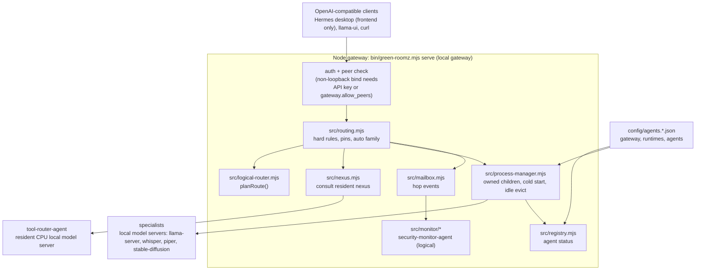
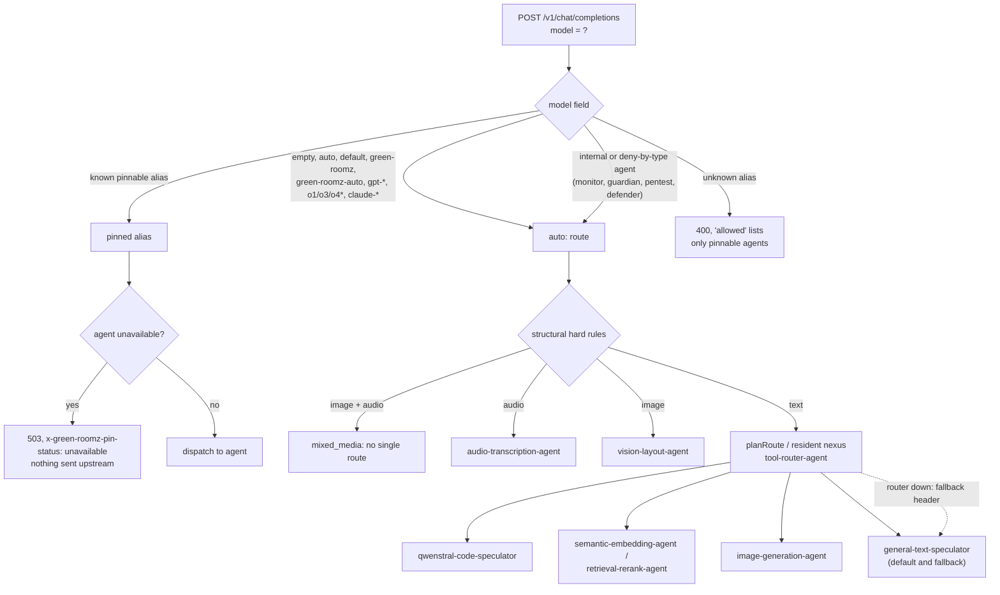
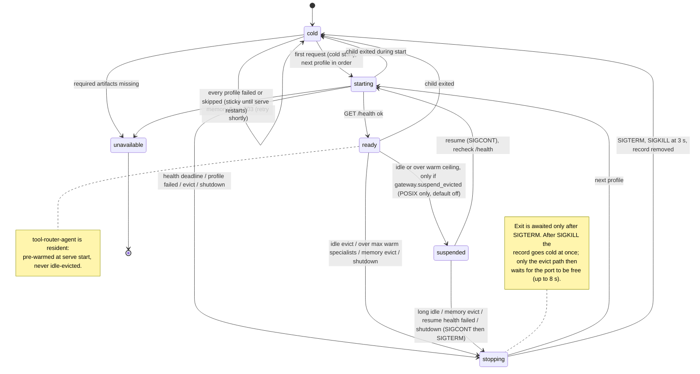
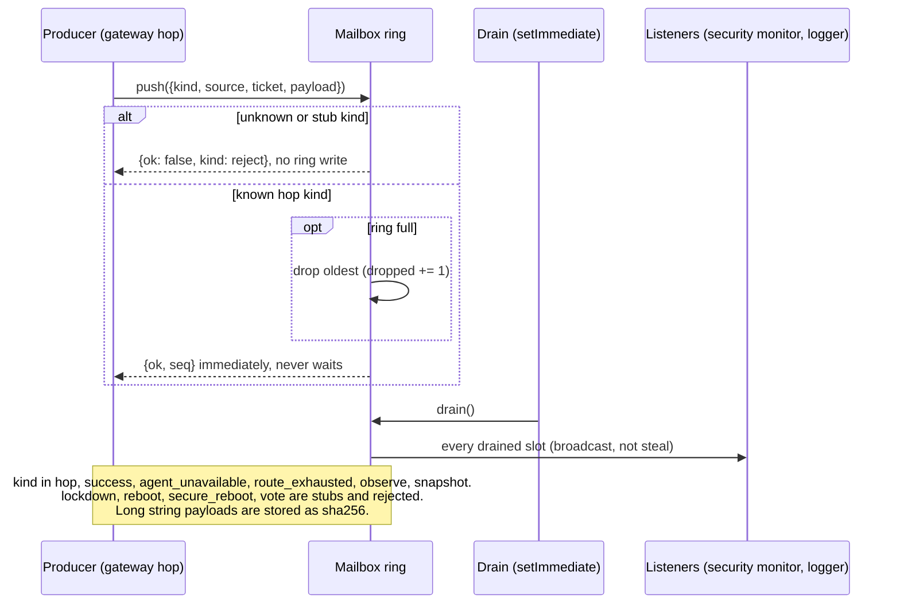
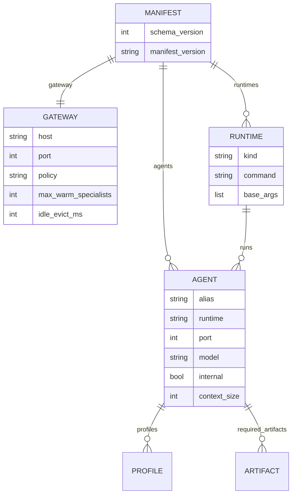
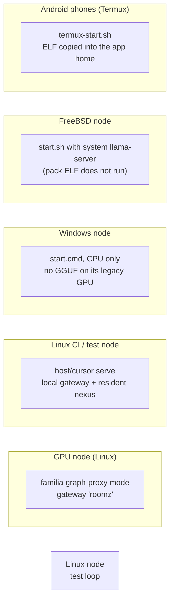

# Green-Roomz

Green-Roomz is a local, OpenAI-compatible agent gateway that maps stable functional aliases to host-qualified inference backends. It is llama.cpp-first, but runtime-agnostic: Whisper, Piper/Kokoro, stable-diffusion.cpp, native Android sidecars, and future engines use the same adapter contract.

This is the first executable implementation. It includes:

- a validated ten-agent manifest;
- truthful native and gateway capability reporting;
- structural image/audio hard-rules plus a resident CPU nexus for text routing;
- owned subprocess lifecycle management without killing unrelated processes;
- concurrent backends with `responsive`, `balanced`, and `maximize` policies;
- health-driven cold starts and safe pre-stream retries;
- benchmark caching and multi-pass profile selection;
- Windows and Android host fingerprints;
- a dependency-free Node gateway and test suite.

## Try it (open image)

CPU-only container — no mvp-host GPU required. Details: [packaging/README.md](packaging/README.md).

```bash
docker pull ghcr.io/brianreborn/green-roomz:try
docker run --rm -p 8080:8080 ghcr.io/brianreborn/green-roomz:try
```

Bearer token: `try-local`. GitHub Actions builds the image on `main`.

**VM kit** (Debian qcow2 + seed ISO): release tag [`try-vm`](https://github.com/brianreborn/green-roomz/releases/tag/try-vm) — [packaging/vm/README.md](packaging/vm/README.md). ([#19](https://github.com/brianreborn/green-roomz/issues/19))

## Quick start (Linux)

**One local path** — full detail in [INSTALL.md](INSTALL.md):

```bash
git clone https://github.com/brianreborn/green-roomz.git
cd green-roomz
chmod +x install.sh start.sh stop.sh smoke.sh runtime/llama-server
./install.sh          # detect-only doctor (no serve, no fetch)
./start.sh            # http://127.0.0.1:8080  (config/agents.cursor.json)
```

Need Node on PATH (`>=22`; Node 20 works). Tip trees may already have the nexus GGUF under `models/`; slim packs do not — drop `Qwenstral-Small-3.1-0.5B.Q4_K_M.gguf` before start. Missing specialty artifacts report as unavailable; they do not block the gateway.

Gateway default: `127.0.0.1:8080`. Set `GREEN_ROOMZ_API_KEY` for bearer auth. Public bind needs the key and `GREEN_ROOMZ_ALLOW_PUBLIC=1`.

**Windows:** [INSTALL-WINDOWS.md](INSTALL-WINDOWS.md) (`install-windows.cmd` / `start.cmd`) — not the first step on Linux.
**Android / FreeBSD:** [docs/diagrams/install-platforms.md](docs/diagrams/install-platforms.md).

## Diagrams

Mermaid diagrams of `host/cursor` (`8f6f1e1`), rendered by GitHub. Existing operator diagrams stay in [docs/diagrams/](docs/diagrams/): [serve topology](docs/diagrams/serve-topology.md), [install platforms](docs/diagrams/install-platforms.md) and [memory stack](docs/diagrams/memory-stack.md).

### Components



### Request routing



A registered agent alias always wins over an auto-family match. Once an agent is chosen, the request takes an admission slot (`PolicyGate.acquire`: FIFO, `maxHeavyInFlight` per policy), then `ensure()` cold-starts the backend if needed, `pin()` holds it, the request is proxied, and `unpin` / `release` run in that order. Every hop is published to the mailbox, and responses carry `x-green-roomz-requested-alias` and `x-green-roomz-effective-alias`.

### Backend lifecycle (`src/process-manager.mjs`)



Non-resident cold starts are serialized on one chain; the resident nexus starts outside it. Concurrent requests for the same alias share one start, and a client abort never cancels a spawn or its health wait. The default idle path is terminate, not suspend.

### Mailbox and monitor IPC (`src/mailbox.mjs`)



### Manifest model (`config/agents.*.json`)



### Where it runs



## Commands

```text
green-roomz validate [--manifest path]   # optional diagnostic — not required before ./start.sh
green-roomz compile [--manifest path] [--check]
green-roomz serve [--manifest path] [--host address] [--port number]
green-roomz benchmark [alias|all] [--manifest path] [--quick] [--force]
green-roomz deploy [--manifest path] [--quick]
green-roomz fingerprint
```

`compile` writes the layered "stock" system prompts to `build/prompts/` (agency /
memory-feedback-loop / confidence frames + each agent kernel). See
[docs/stock-prompts.md](docs/stock-prompts.md) and the hands-on skill
[skills/green-stock-prompt/](skills/green-stock-prompt/SKILL.md).

Benchmarking never runs on every request. Results are cached by host fingerprint, driver/runtime identity, agent manifest digest, artifact identity, and candidate profile. A changed fingerprint causes requalification.

## Current scope

Artifacts for all ten aliases now live under `C:\LocalAI` (including `Qwen3-4B-eagle3-BF16.gguf`). A serve process started before those downloads will still report them unavailable until it is restarted.

`tool-router-agent` is a resident CPU nexus (0.5B on :8187, `--device none --threads 2`) pre-warmed at serve start and kept loaded. Each chat turn POSTs the latest user message to that live kernel; specialists HANDOFF after a few tokens if the job is not theirs. Regex intent over the transcript is not the production router.

## sm11 GPU assist (optional, mvp-host 8600 GT)

Optional CUDA 6.5 / sm_11 mailbox + monitor hot-path assists. Details: [native/sm11-monitor/README.md](native/sm11-monitor/README.md). CPU fallback always remains.

| Knob | Effect |
| --- | --- |
| `GRZ_SM11=1` | **Mailbox:** enables sm11 (`verifyOnFat` + hot path). **MonitorIpc:** enables fat verify + hot path (assist is otherwise auto-wired but quiet). |
| `GRZ_SM11=0` | Disables sm11 everywhere. |
| `{ sm11: true }` / `{ sm11: {…} }` | Explicit enable (Mailbox / logger); object form can override `preferRing`, `serve`, etc. |

**`preferRing` default:** when sm11 is on and `sm11_monitor.exe` is present, assist opens a persistent `--serve` session and **`preferRing` defaults on**. Hot path then prefers ring assists (enqueue → `assistRingPush`, drop/clear → `assistRingScrub`, drain → `assistRingDrain`, wait → `assistRingVerify`) and falls back to seq/scrub/batch (CPU twin OK) if ring fails. Also: mailbox stub/invalid reject and MonitorIpc reject-cache hits → `onReject`/`assistSeq`. Optional ring index mirror assists: `assistRingSyncMeta` / `assistRingDumpMeta` (host-authoritative `{head,tail,count}` H2D/D2H — not CUDA-owned; see `native/sm11-monitor/README.md`). Vote/lockdown/quarantine/clear-all are not separate CUDA hooks (stubs reject on host; quarantine is policy; no clear-all API — drain already scrubs). Override with `{ preferRing: false }` or `serve: false`. Without the exe, hot path uses the probe assists only (no serve session).

## McAfee on win-host

McAfee Premium Real-Time Scanning false-positives operator PowerShell (serve bounce, elevated `netsh`). Do not disable it. Exclude `C:\LocalAI`, both Green-Roomz trees, and `C:\Program Files\nodejs`. Full click-path and the WLAN autoconfig fix: [docs/mcafee-win-host.md](docs/mcafee-win-host.md).

Android support currently defines the host/sidecar protocol and fingerprint boundary. The recommended mobile deployment places the gateway in Termux or a container and exposes accelerator-backed inference through a native Android sidecar.
