# Install platforms — Linux, Windows, Android, FreeBSD

Portable pack. Need **Node on PATH** (`package.json` engines `>=22`; **Node 20
works**). Gateway `http://127.0.0.1:8080`. Nexus `:8187`. ~1.5 GB RAM free.
Do not stop a live cursor serve on those ports from another pack's `stop`.

```mermaid
flowchart TB
  subgraph linux ["Linux x86_64"]
    L1["unzip/clone; chmod +x install.sh start.sh … runtime/llama-server"]
    L2["./install.sh then ./start.sh"]
    L3["vendored runtime/llama-server + .so<br/>LD_LIBRARY_PATH=runtime/"]
    L1 --> L2 --> L3
  end

  subgraph windows ["Windows — no admin, CPU only"]
    W1["install-windows.cmd → %LOCALAPPDATA%\\Green-Roomz"]
    W2["start.cmd  or Start Menu shortcut"]
    W3["If runtime\\llama-server.exe missing:<br/>fetch llama-b10702-bin-win-cpu-x64.zip<br/>NEVER vulkan / CUDA; NEVER GGUF on 8600 GT"]
    W4["help\\index.html  — this HTML help"]
    W1 --> W2 --> W3
    W2 --> W4
  end

  subgraph android ["Android — no root, no Knox"]
    A1["Host: ./deploy-android.sh  (adb device)"]
    A2["Drop zone /data/local/tmp/grz  — SELinux: Termux cannot EXEC tmp"]
    A3["On phone, Termux: bash /data/local/tmp/grz/termux-start.sh"]
    A4["Copies ELF into $HOME and serves :8080"]
    A1 --> A2 --> A3 --> A4
  end

  subgraph fbsd ["FreeBSD / other Unix"]
    F1["Pack llama-server is a Linux ELF — will not run"]
    F2["pkg install llama-cpp   or build ggml-org/llama.cpp"]
    F3["./start.sh uses system llama-server if present"]
    F1 --> F2 --> F3
  end
```



## Linux (happy path)

```bash
unzip green-roomz-beta-*-full.zip   # or git clone tip; slim zip: drop the 0.5B GGUF into models/
cd green-roomz
chmod +x install.sh start.sh stop.sh smoke.sh console.sh runtime/llama-server
./install.sh    # doctor; no serve
./start.sh
```

See root [INSTALL.md](../../INSTALL.md).

Stop: `./stop.sh` or Ctrl-C. Console: `./console.sh` (every 2s;
`CONSOLE_ONCE=1 ./console.sh` once). A one-shot board may also be written to
`data/console.txt` at start.

Slim zip has no GGUF; full zip has `models/Qwenstral-Small-3.1-0.5B.Q4_K_M.gguf`.

## Windows (no admin; CPU only)

The `.cmd` **is** the installer for v1. No `.exe`, no `.msi`, no UAC, no
self-signed cert.

| Action | Where |
|---|---|
| Install | `install-windows.cmd` → `%LOCALAPPDATA%\Green-Roomz` |
| Start | Start Menu → Green-Roomz, or `start.cmd` |
| Help | `help\index.html` (this pack; open in the browser) |
| Gateway | http://127.0.0.1:8080 |
| Stop | `stop.cmd` or Ctrl-C in the serve console |
| Uninstall | `uninstall-windows.cmd` (LocalAppData + Start Menu only) |

If Node is missing, the installer prints the official LTS MSI URL and exits 1.
It does not download Node. Install yourself, open a **new** cmd window, retry.

qodesh 8600 GT is display-only (224 MB, sm_1.1). Manifest stays
`--device none --n-gpu-layers 0`. Do not install CUDA 6.5. Do not fetch
vulkan/cuda llama zips.

`stop.cmd` is Windows loopback (`127.0.0.1:8080` / `:8187`) only. It must not
be used against the Linux cursor serve.

## Android (no root, no Knox)

From a host with adb:

```bash
./deploy-android.sh
```

Pushes to `/data/local/tmp/grz`. On the phone in Termux:

```bash
bash /data/local/tmp/grz/termux-start.sh
```

That copies the ELF into `$HOME` and serves. Do not `su`. Host forward:

```bash
adb forward tcp:18080 tcp:8080
```

See [`../note9-termux.md`](../note9-termux.md).

## FreeBSD / other Unix

This pack's `runtime/llama-server` is a Linux ELF. `start.sh` will use a system
`llama-server` if present (`pkg install llama-cpp` or build from
ggml-org/llama.cpp). No VM is bundled.

macOS: same idea (`brew install llama.cpp`) if the Linux binary will not run.

## Operator usage drop-in (all platforms)

Copy `data/operator-usage.example.json` → `data/operator-usage.json` and fill
**real** numbers. Do not leave a fake file.

`context_fill_pct` is **total cache fill L0+L1+L2+L3 combined**. The 70% hold is
that combined cache, not L0 alone. There is an L3. The console never invents
tokens or fill.

## Health / smoke

```bash
curl -s http://127.0.0.1:8080/health
./smoke.sh
```

Known this beta: health is **degraded** when vision/whisper/embed/rerank/guard/
piper/sd artifacts are missing. `POST /lockdown` and `POST /reboot` 404. Default
llama profile is **cpu-4** (4 threads).
