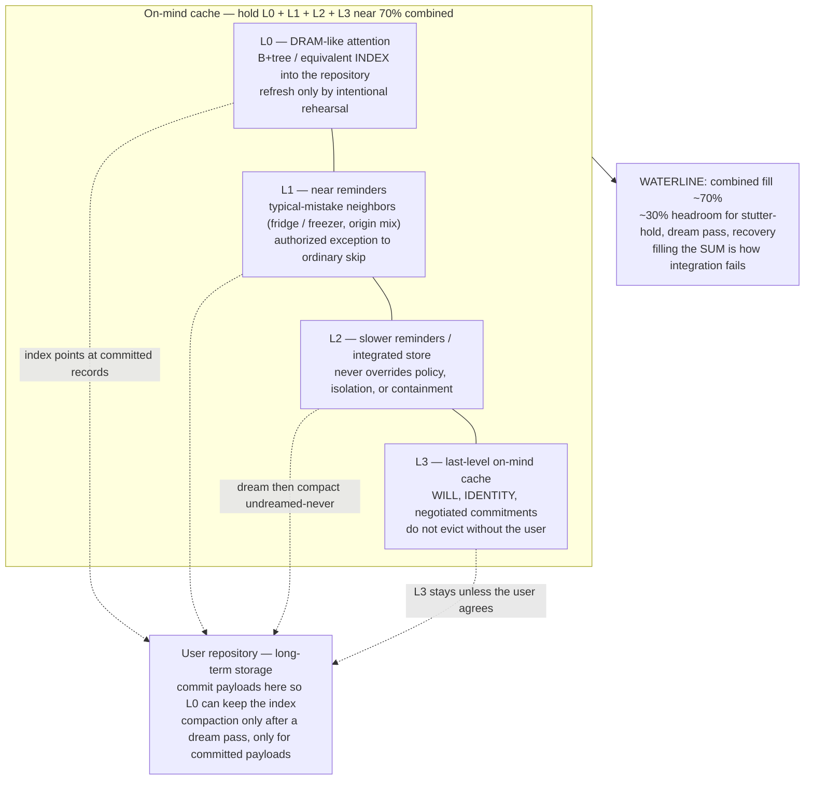

# Memory stack — L0–L3 + 70% waterline + repository

Operator diagram for the on-mind cache. Canonical prose:
[`../strong-mind-will.md`](../strong-mind-will.md) and
`policies/frames/memory-feedback-loop.md`.

**70% fill is L0+L1+L2+L3 combined**, not L0 alone. L3 is will / identity
last-level on-mind cache. Occupancy numbers are operator facts — this diagram
does not invent them. Prefer `data/operator-usage.json` (`context_fill_pct` is
the combined percent, or `null` if unmeasured).

## Six-state coordinates on the same stack

States are coordinates, not a queue. Stutter and fugue are edge holds, not extra
layers.

```mermaid
stateDiagram-v2
  [*] --> derivation: expressed, not yet durable
  derivation --> attention: admit to working set\nSTUTTER hold here if neighbors tie
  attention --> integration: durable record + associations\nFUGUE if this edge fails
  integration --> partition: ordinary recall skips
  partition --> containment: recall denied until authorized release\ncontainment is not deletion
  containment --> disintegration: associations decay; provenance kept
  disintegration --> derivation: a later thought is a NEW derived record
```

## Operator rules (no invented fill)

| Do | Do not |
|---|---|
| Read `data/operator-usage.json` | Guess `context_fill_pct` |
| Treat 70% as **L0+L1+L2+L3** | Treat 70% as L0 alone |
| Dream, then compact | Compact undreamed items |
| Keep L3 unless the user agrees | Evict will / identity to make room |
| Say fill is unknown if the file is absent | Narrate a fake waterline |

This stack is **not** host RAM admission (`src/memory.mjs`) and **not** the
llama.cpp KV cache. Those are process-memory facts. Combined on-mind fill is a
cognitive / operator fact.
