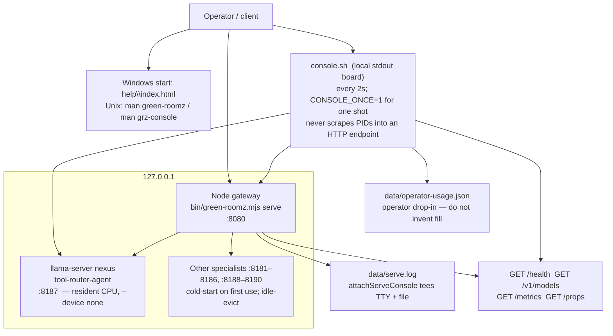
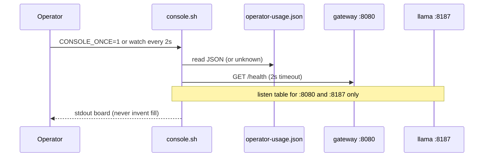

# Serve topology — gateway :8080, llama :8187, console, usage

Live loopback topology. Do **not** stop listeners on `:8080` / `:8187` from a
docs edit or from a Windows `stop.cmd` aimed at this Linux cursor serve.

Canonical ops: [`../deployment.md`](../deployment.md). Console: `console.sh`
(`grz-console(1)`). Occupancy: `data/operator-usage.json` only.

## Ports (this pack)

| Port | Process | Role |
|---|---|---|
| **8080** | `node` (`green-roomz serve`) | OpenAI-compatible gateway. The only thing clients talk to. |
| **8187** | `llama-server` | Resident 0.5B CPU nexus (`tool-router-agent`). Pre-warmed at serve start. |
| 8181–8186, 8188–8190 | specialists | Cold-start; not required for the nexus path. Missing artifacts → degraded health, not a dead gateway. |
| — | `security-monitor-agent` | Logical; no process. See security-monitor docs. |

Default bind is loopback. Public bind requires `GREEN_ROOMZ_API_KEY` and
`GREEN_ROOMZ_ALLOW_PUBLIC=1`. Peer LAN: `--allow-peer <ip>`.

## Console data path

`console.sh` prints, it does not serve:

1. `node :8080` pid / threads / rss / cpu (from the listen table + `/proc`)
2. `llama :8187` same
3. GGUF names under `models/` (size from `stat`, not occupancy)
4. `GET http://127.0.0.1:8080/health` (status / policy / ready aliases)
5. Occupancy **only** from `data/operator-usage.json`

If the usage file is missing, the board says `usage: unknown … do not guess`.
The 70% hold printed next to a real `context_fill_pct` is
**L0+L1+L2+L3 combined**, not L0 alone.

## Process ownership

The gateway owns backends it started. `green-roomz stop` / `stop.sh` drains
**owned** processes. Do not use Windows `stop.cmd` against this Linux serve.
Do not `kill` unrelated `node` or `llama-server` PIDs.
